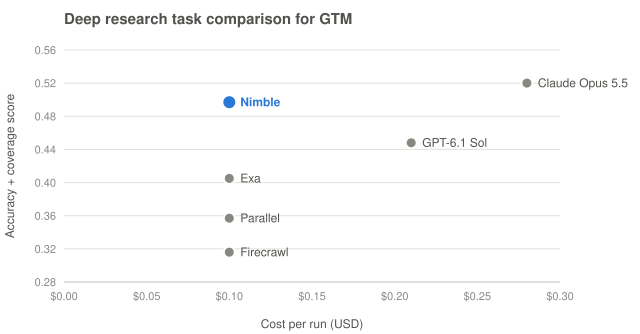

# Nimble for GTM Research

Agent skills that give your AI agent (Claude, ChatGPT, Cursor, Codex and others) the live web as cited, structured data for go-to-market work: account research, buying signals, prospect lists and CRM enrichment, powered by [Nimble](https://www.nimbleway.com).

| Skill | What it does |
| - | - |
| [`onboard-your-agent`](skills/onboard-your-agent/SKILL.md) | Start here. Shows the GTM benchmark chart (deep research task comparison for GTM) and the four use cases as tiles for testing Nimble's APIs in your AI plus a tile for integrating them into your stack, gets you onto a free Nimble trial and connected, then routes your request. |
| [`account-deep-research`](skills/account-deep-research/SKILL.md) | Cited account research with 12 GTM Web Search Agents (account brief, account signals, buying trigger monitor, decision makers, competitive intelligence, brand intelligence, social media monitor, account enrichment, GTM account enrichment, account discovery, ICP discovery, local business discovery), plus a playbook for building your own agent when none fits. |
| [`account-fast-search`](skills/account-fast-search/SKILL.md) | Answers in seconds with Nimble Search, Extract and Extract Templates: query patterns, first-party source priority, date scoping, entity disambiguation and privacy-safe sourcing for any account, person or competitor question. |
| [`account-lists-and-enrichment`](skills/account-lists-and-enrichment/SKILL.md) | Build ICP and local account lists with near-misses, and enrich CSVs and CRM records at scale: batching, concurrency, verification gates, precedence rules for conflicting sources and safe CRM write-back. Includes the Search API pipeline for when your code owns the workflow. |
| [`gtm-data-at-scale`](skills/gtm-data-at-scale/SKILL.md) | Track GTM signals over time with Extract Templates: hiring across target accounts, software and employee reviews, local business listings, search and AI-answer visibility, social activity. Batch runs of up to 1,000 inputs, scheduled Extract Jobs into S3 or Databricks, and template generation for sites without one. |

## Quick start

1. **Get a free trial:** https://online.nimbleway.com/signup
2. **Connect Nimble to your agent.** The MCP server (`https://mcp.nimbleway.com/mcp`) uses OAuth, so no API key is needed. In Claude Code it comes bundled with the plugin in step 3, so there's nothing else to install: run `/mcp` and authorize **nimble**. For enriching whole CSVs, template batches and Jobs, also install the CLI (`npm i -g @nimble-way/nimble-cli`) and set `NIMBLE_API_KEY` from https://online.nimbleway.com/settings/api-keys.
3. **Install the skills**

   Claude Code (one plugin: the skills plus the Nimble MCP server):

   ```bash
   claude plugin marketplace add Nimbleway/nimble-for-gtm-research
   ```

   ```bash
   claude plugin install nimble-gtm-research@nimble-gtm-research
   ```

   Cursor, Codex and other agents:

   ```bash
   npx skills add Nimbleway/nimble-for-gtm-research
   ```

   Claude.ai: zip a folder under `skills/` and upload it under **Customize → Skills**. ChatGPT or any other agent: add the `SKILL.md` files to the project or GPT instructions.

4. **Say "onboard my agent for GTM research"** and answer one question: what GTM research do you want to test? Or try: *"Prepare me for a meeting with Gong (gong.io)."*

   To call the same APIs from your own code, agents, CRM or warehouse, see https://docs.nimbleway.com/integrations/overview.

## Example requests

- "Prepare me for a meeting with Gong (gong.io). I'm meeting their VP of RevOps."
- "Check Mercury (mercury.com) for changes since 2026-09-21."
- "Monitor Cato Networks, Mark43, BlueVoyant and commercetools for buying triggers in the last 30 days. We sell revenue software to B2B SaaS companies."
- "At Brex, find the current head of data, VP engineering, head of revenue operations and CFO."
- "Compare Slack, Microsoft Teams and Google Chat on published pricing, target customers and recent launches."
- "Who is Datadog's current CRO, and since when?" (fast search)
- "Find up to 15 US legal AI companies, Series A to C since April 2025, 50 to 500 employees, hiring AEs. Show near-misses." (lists)
- "Enrich these 200 domains with HQ, headcount, last round and CRO, and flag conflicts before we import to Salesforce." (enrichment)
- "Track new sales job postings at our top 300 accounts every Monday." (GTM data at scale)
- "Every week, ask ChatGPT, Perplexity and Google AI Mode the 20 buyer questions in our category and track whether we are mentioned." (GTM data at scale)

## Principles every skill follows

- **Public information only.** No logged-in, paywalled or purchased data, and no emails or phone numbers constructed from patterns.
- **First-party sources first.** The company's own site, newsroom, careers page and ATS board, then filings and registries, then reputable press; aggregators are for discovery.
- **Every value is sourced and dated.** If nobody published a value, it is reported as not found, not estimated. Lists are never padded to reach a count.
- **Event dates, not article dates.** A signal counts when the event happened in the window, not when a story about it was republished.

## Benchmark

<picture>
  <source media="(prefers-color-scheme: dark)" srcset="skills/onboard-your-agent/assets/benchmark-chart-dark.svg">
  
</picture>

*GTM Use-Case Benchmark v2, 10 tasks, November 2026. Higher and further left is better.*

In Nimble's public GTM Use-Case Benchmark v2 (meeting prep and signal tracking, 10 tasks, six providers, November 2026), Nimble scored highest of the four research APIs at the same $0.10 a run (0.497), found the most verified facts of any provider and had the best signal-tracking score, at about a third of Claude Opus 5.5's cost. Claude Opus 5.5 scored higher overall (0.520), mostly on meeting prep. Tables, method and caveats: [`benchmark/README.md`](benchmark/README.md).

## Layout

```
skills/
  onboard-your-agent/SKILL.md
  onboard-your-agent/assets/                    # prebuilt benchmark chart + tiles (inline fragment, page, PNG, SVGs) and build.py
  account-deep-research/SKILL.md
  account-deep-research/agents/*.json           # 12 agent specs: skill, output schema, example questions
  account-fast-search/SKILL.md
  account-fast-search/references/source-map.md
  account-lists-and-enrichment/SKILL.md
  gtm-data-at-scale/SKILL.md
  gtm-data-at-scale/references/template-catalog.md
benchmark/README.md                             # GTM Use-Case Benchmark v2 results
.claude-plugin/                                 # Claude Code plugin + marketplace manifests
.mcp.json                                       # Nimble MCP server, bundled with the Claude Code plugin
```

Nine of the agent specs are snapshots of Nimble's Web Search Agent gallery; three (`gtm-buying-trigger-monitor`, `gtm-account-enrichment`, `gtm-icp-discovery`) come from Nimble's [GTM developer guide](https://www.nimbleway.com/blog/building-gtm-agents-three-use-cases-with-nimbles-apis) and its runnable apps in [Nimbleway/cookbook](https://github.com/Nimbleway/cookbook/tree/main/apps).

## Docs

- Nimble docs: https://docs.nimbleway.com (machine index: https://docs.nimbleway.com/llms.txt)
- Web Search Agents: https://docs.nimbleway.com/nimble-sdk/web-search-agents/overview
- Running agents at scale: https://docs.nimbleway.com/nimble-sdk/web-search-agents/best-practices/running-at-scale
- Search: https://docs.nimbleway.com/nimble-sdk/web-tools/search
- Extract Templates: https://docs.nimbleway.com/nimble-sdk/web-tools/extract/template
- Extract Jobs: https://docs.nimbleway.com/nimble-sdk/agentic/jobs

## License

MIT
