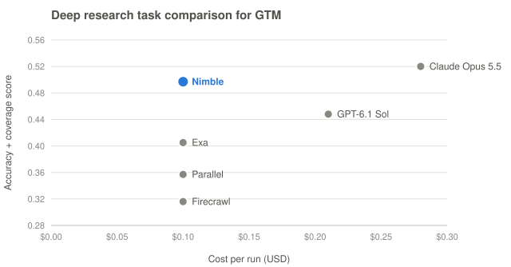

# Benchmark: GTM research

<picture>
  <source media="(prefers-color-scheme: dark)" srcset="../skills/onboard-your-agent/assets/benchmark-chart-dark.svg">
  
</picture>

*GTM Use-Case Benchmark v2, 10 tasks, November 2026. Higher and further left is better.*

How well do web research agents do the jobs these skills are for? This page summarizes Nimble's public **GTM Use-Case Benchmark v2** (runs November 3 to 10, 2026; judged November 10; corrections November 11). The full method, task instructions, raw provider outputs, verdicts and answer keys are in [Nimbleway/Public-benchmarks/GTM-Use-Case-Benchmark](https://github.com/Nimbleway/Public-benchmarks/tree/main/GTM-Use-Case-Benchmark); the numbers below are copied from its `results/summary.json`.

## How it is scored

Every provider gets the same instructions and output schema for a job. A judge (Claude Sonnet 5.5) breaks each answer into atomic facts, fetches every page any provider cited, and marks each fact true, wrong, off scope or unverifiable. Then:

- **Coverage**: weighted share of all facts verified true (from any provider) that this provider found.
- **Accuracy**: weighted share of the provider's own facts that were right (unverifiable counts as half wrong).
- **Combined**: meeting prep is a decision job where an error is costly, so it uses F1 of accuracy and coverage, scaled by how many critical answer-key questions the provider got right (the keys were written by a separate run before any provider output was seen). Signal tracking, where reviewing an extra event is cheap, uses F2, which weights coverage twice.

Unit weights: for meeting prep, a finding weighs 6 if critical to the seller, 2 if useful, 0.5 if minor, x1.5 when fresh (last 90 days or current state). For signal tracking, a buying signal after the since-date (funding, leadership, expansion, hiring push, major launch, M&A, pricing) weighs 3 and a minor release 0.5.

Both GTM jobs run at the medium tier. The four research APIs are matched on list price per run (about $0.10); GPT-6.1 Sol and Claude Opus 5.5 run with their own web tools at medium effort.

## Results (10 tasks)

| Provider | Combined | Accuracy | Coverage | Critical key items correct | Facts (true / wrong) | Wins | Avg cost / run | Median seconds |
| :--- | :---: | :---: | :---: | :---: | :---: | :---: | :---: | :---: |
| Claude Opus 5.5 | **0.520** | 0.992 | 0.419 | **0.950** | 148 / 1 | 4/10 | $0.28 | 80 |
| Nimble | 0.497 | 0.960 | **0.427** | 0.750 | **157** / 5 | 3/10 | $0.10 | 134 |
| GPT-6.1 Sol | 0.448 | 0.999 | 0.375 | 0.700 | 144 / 1 | 3/10 | $0.21 | 60 |
| Exa | 0.405 | 0.979 | 0.345 | 0.610 | 129 / 1 | 0/10 | $0.10 | 99 |
| Parallel | 0.357 | 0.981 | 0.314 | 0.430 | 121 / 3 | 0/10 | $0.10 | 230 |
| Firecrawl | 0.316 | 0.932 | 0.279 | 0.470 | 127 / 5 | 0/10 | $0.10 | 112 |

Critical key items are averaged over the five meeting prep tasks (signal tracking has no answer key). Firecrawl's average cost is $0.096.

Combined score by job (mean of 5 tasks):

| Job | Metric | Nimble | Exa | Parallel | Firecrawl | GPT-6.1 Sol | Claude Opus 5.5 |
| :--- | :---: | :---: | :---: | :---: | :---: | :---: | :---: |
| Meeting prep and account research | F1 | 0.430 | 0.346 | 0.226 | 0.294 | 0.385 | **0.496** |
| Track signals that create sales opportunities | F2 | **0.564** | 0.465 | 0.488 | 0.337 | 0.511 | 0.543 |

Combined score per input:

| Task | Nimble | Claude Opus 5.5 | GPT-6.1 Sol | Exa | Parallel | Firecrawl |
| :--- | :---: | :---: | :---: | :---: | :---: | :---: |
| Meeting prep: Attio | 0.466 | **0.484** | 0.377 | 0.281 | 0.206 | 0.328 |
| Meeting prep: Datadog | **0.575** | 0.524 | 0.438 | 0.415 | 0.141 | 0.308 |
| Meeting prep: Gong | **0.586** | 0.550 | 0.445 | 0.443 | 0.391 | 0.419 |
| Meeting prep: Vercel | 0.305 | **0.374** | 0.268 | 0.348 | 0.184 | 0.294 |
| Meeting prep: Monday.com | 0.217 | **0.549** | 0.398 | 0.241 | 0.209 | 0.123 |
| Signals since 2026-09-21: Mercury | 0.752 | **0.789** | 0.616 | 0.771 | 0.616 | 0.226 |
| Signals: Clay | 0.326 | 0.371 | **0.401** | 0.254 | 0.391 | 0.160 |
| Signals: Rippling | 0.374 | 0.352 | **0.487** | 0.477 | 0.364 | 0.211 |
| Signals: Anthropic | 0.423 | 0.450 | **0.598** | 0.368 | 0.507 | 0.363 |
| Signals: Klarna | **0.943** | 0.754 | 0.455 | 0.455 | 0.564 | 0.726 |

Read it this way: Nimble scored highest of the four research APIs at the same price, found the most verified facts of any provider (157) with the highest coverage, and had the best signal-tracking score, at about a third of Claude Opus 5.5's cost per run. Claude Opus 5.5 scored higher overall, mostly on meeting prep (Monday.com in particular), and got more critical answer-key questions right. The frontier models were the most precise; the API-only providers found less of what the pool found.

## Across GTM and finance (50 tasks)

The same harness, judge and method ran 40 finance tasks alongside these ten ([Finance-Use-Case-Benchmark](https://github.com/Nimbleway/Public-benchmarks/tree/main/Finance-Use-Case-Benchmark)). Across all 50, Nimble had the highest combined score (0.574, Claude Opus 5.5 0.571) at $0.38 a run against $0.69.

## Caveats

- Five inputs per job and one run per provider per task; small differences are within run-to-run noise.
- Nimble wrote the jobs, inputs and instructions. The Nimble arm was rerun on November 9, after Nimble's November extract-template release; the others ran once between November 3 and 10.
- Coverage is relative to what the six providers found together, not an exhaustive answer set.
- The judge and answer-key writer are Claude models, and Claude Opus 5.5 is a contestant. Nimble Extract is one of four page fetchers the judge uses for every provider's citations.
- Signal tracking asks about events after a fixed date, so a later run is a different test.
- The benchmark ran Nimble's general Web Search Agent at medium effort with the benchmark's own instructions and schema, not the agents in `skills/account-deep-research/agents/`.
- Verdicts and keys are model judgments, not reviewed by sales practitioners. Judge agreement with an independent audit model was 79% of 58 sampled units in this suite. See the source README for the full list and the corrections log.

To recompute the tables offline, clone the source repo and run `python -m usecase_bench.summary` in `GTM-Use-Case-Benchmark/`.
